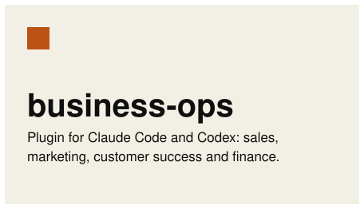
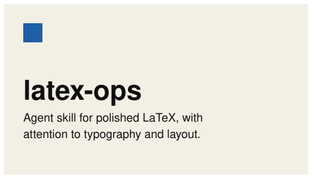
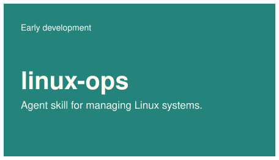
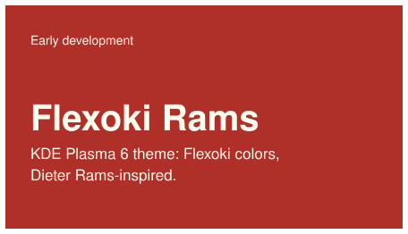

**English** · [Português (Brasil)](README_pt-BR.md)

# About me

Partner at [OpeRH](https://operh.com.br/). Interested in mathematics, AI, Linux, and open-source software. Also into cinema, books, and music.

## What I've been working on

<a href="https://github.com/pv-ca/business-ops"><picture><source media="(prefers-color-scheme: dark)" srcset="assets/projects/en-business-ops-dark.svg"></picture></a><a href="https://github.com/pv-ca/latex-ops"><picture><source media="(prefers-color-scheme: dark)" srcset="assets/projects/en-latex-ops-dark.svg"></picture></a>
<a href="https://github.com/pv-ca/linux-ops"><picture><source media="(prefers-color-scheme: dark)" srcset="assets/projects/en-linux-ops-dark.svg"></picture></a><a href="https://github.com/pv-ca/flexoki-rams"><picture><source media="(prefers-color-scheme: dark)" srcset="assets/projects/en-flexoki-rams-dark.svg"></picture></a>

