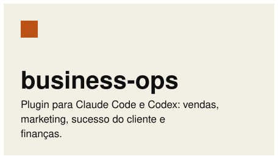
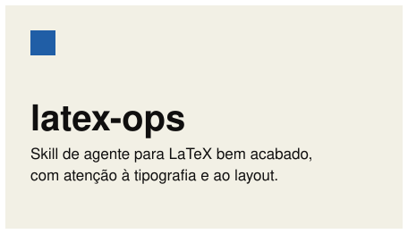
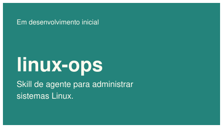
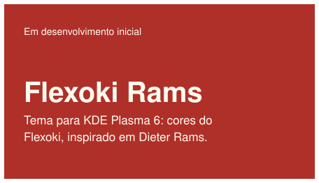

[English](README.md) · **Português (Brasil)**

# Sobre mim

Sócio do [OpeRH](https://operh.com.br/). Interessado em matemática, IA, Linux e software de código aberto. Também curto cinema, livros e música.

## O que ando fazendo

<a href="https://github.com/pv-ca/business-ops"><picture><source media="(prefers-color-scheme: dark)" srcset="assets/projects/pt-business-ops-dark.svg"></picture></a><a href="https://github.com/pv-ca/latex-ops"><picture><source media="(prefers-color-scheme: dark)" srcset="assets/projects/pt-latex-ops-dark.svg"></picture></a>
<a href="https://github.com/pv-ca/linux-ops"><picture><source media="(prefers-color-scheme: dark)" srcset="assets/projects/pt-linux-ops-dark.svg"></picture></a><a href="https://github.com/pv-ca/flexoki-rams"><picture><source media="(prefers-color-scheme: dark)" srcset="assets/projects/pt-flexoki-rams-dark.svg"></picture></a>

